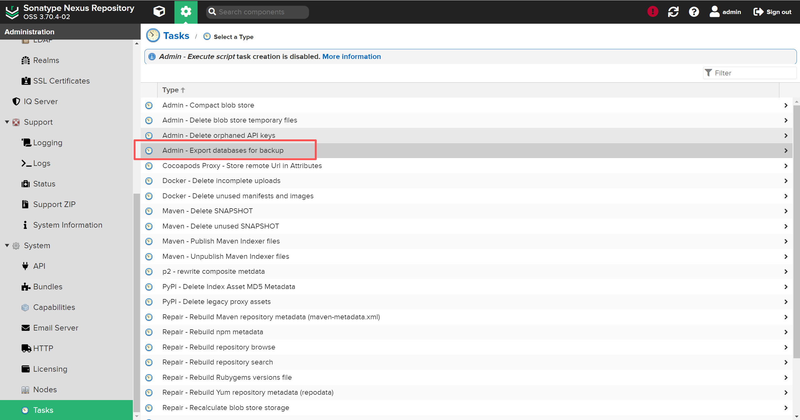

# Nexus升级

### 先备份

### 1\. 准备Java运行环境

- java8 nexus 3\.63\.0 运行环境（旧版）

- java11 nexus 3\.70\.4 数据库迁移工具 运行环境

- java17 nexus 3\.86\.0 运行环境

- java21 nexus 3\.87\.1 运行环境

```plain
[root@localhost jdk]# ll -tr
总用量 680712
-rw-rw-rw- 1 root root 148447944 6月   5 15:14 jdk-8u441-linux-x64.tar.gz
drwxr-xr-x 8 root root       294 6月   5 15:15 jdk1.8.0_441
-rw-rw-rw- 1 root root 182722765 6月   5 17:20 jdk-17.0.18_linux-x64_bin.tar.gz
-rw-rw-rw- 1 root root 168369797 6月   5 17:22 jdk-11.0.30_linux-x64_bin.tar.gz
-rw-rw-rw- 1 root root 197498247 6月   5 17:22 jdk-21.0.10_linux-x64_bin.tar.gz
drwxr-xr-x 9 root root       126 6月   5 17:54 jdk-11.0.30
drwxr-xr-x 9 root root       136 6月   5 17:54 jdk-17.0.18
drwxr-xr-x 9 root root       136 6月   5 17:54 jdk-21.0.10
```

#### 下载nexus版本

```plain
wget https://cdn.download.sonatype.com/repository/downloads-prod-group/3/nexus-3.70.4-02-java8-unix.tar.gz 
wget https://cdn.download.sonatype.com/repository/downloads-prod-group/3/nexus-3.73.0-12-unix.tar.gz
wget https://cdn.download.sonatype.com/repository/downloads-prod-group/3/nexus-3.77.2-02-unix.tar.gz 
wget https://download.sonatype.com/nexus/3/nexus-3.86.2-01-linux-x86_64.tar.gz
wget https://download.sonatype.com/nexus/3/nexus-3.87.1-01-linux-x86_64.tar.gz
```

#### 下载数据库迁移工具

```plain
wget https://cdn.download.sonatype.com/repository/downloads-prod-group/nxrm3-migrator/nexus-db-migrator-3.70.4-02.jar
```

### 2\. 操作步骤

#### 2\.1\. 检查当前数据库


#### Nexus升级至3\.70\.4版本

Nexus 3\.70\.4是支持OrientDB的最后一个版本。需要先升级至3\.70\.4，然后使用数据库迁移工具完成数据库转换（OrientDB–\>H2）

```plain
[root@localhost jdk]# mkdir /data/nexus-3.70.4
[root@localhost nexus-3.70.4]# tar -xf ~/nexus-3.70.4-02-java8-unix.tar.gztar.gz -C ./
```

1. 拷贝旧数据目录覆盖nexus\-3\.70\.4的数据目录

```plain
[root@localhost nexus-3.70.4]# \cp -rf /data/nexus/sonatype-work/* sonatype-work/
```

1. 启动服务升级

```plain
[root@localhost bin]# cd /data/nexus-3.70.4/nexus-3.70.4-02/bin/
[root@localhost bin]# ls
contrib  nexus  nexus.rc  nexus.vmoptions
[root@localhost bin]# ./nexus start
WARNING: ************************************************************
WARNING: Detected execution as "root" user.  This is NOT recommended!
WARNING: ************************************************************
Starting nexus
```

1. 访问服务ip:8081


### 3\. Nexus迁移数据库

1. 创建备份目录，拷贝迁移程序

```plain
[root@localhost nexus-3.70.4]# mkdir nexus_bachup   
[root@localhost nexus-3.70.4]# cp ~/nexus-db-migrator-3.70.4-02.jar nexus_bachup/
```

1. 生成数据库备份

Admin \- Export Database for backup




1. 执行备份任务


1. 查看备份文件

```plain
[root@localhost nexus_bachup]# ll -tr
总用量 56184
-rw-r--r-- 1 root root 56809625 6月   5 18:08 nexus-db-migrator-3.70.4-02.jar
-rw-r--r-- 1 root root   123447 6月   5 18:12 security-2026-06-05-18-12-27-3.70.4-02.bak
-rw-r--r-- 1 root root   156169 6月   5 18:12 analytics-2026-06-05-18-12-27-3.70.4-02.bak
-rw-r--r-- 1 root root   185929 6月   5 18:12 config-2026-06-05-18-12-27-3.70.4-02.bak
-rw-r--r-- 1 root root   242435 6月   5 18:12 component-2026-06-05-18-12-27-3.70.4-02.bak
```

1. 执行迁移数据库程序

- 停止nexus

```plain
nexus stop
```

- nexus\-db\-migrator\-3\.70\.4\-02\.jar 需要Java11\(使用openjdk\) 运行环境

```plain
export JAVA_HOME=/usr/local/jvm/java11
export PATH=$JAVA_HOME/bin:$PATH
```

```plain
[root@localhost jdk-11.0.30]# cd /data/nexus-3.70.4/nexus_bachup/
#根据服务器内存调参数
[root@localhost jdk-11.0.30]# java -Xmx16G -Xms16G -XX:+UseG1GC -XX:MaxDirectMemorySize=28672M -jar nexus-db-migrator-*.jar --migration_type=h2
```

- 转换后生成nexus\.mv\.db

```plain
[root@localhost nexus_bachup]# ll -tr nexus.mv.db 
-rw-r--r-- 1 root root 241664 6月   5 18:35 nexus.mv.db
```

1. 拷贝数据库到存储目录

```plain
[root@localhost nexus_bachup]# cp nexus.mv.db /data/nexus-3.70.4/sonatype-work/nexus3/db/
```

1. 修改nexus\.properties配置

- 增加 nexus\.datastore\.enabled=true

```plain
[root@localhost nexus_bachup]# cat /data/nexus-3.70.4/sonatype-work/nexus3/etc/nexus.properties
# Jetty section
# application-port=8081
# application-host=0.0.0.0
# nexus-args=${jetty.etc}/jetty.xml,${jetty.etc}/jetty-http.xml,${jetty.etc}/jetty-requestlog.xml
# nexus-context-path=/

# Nexus section
# nexus-edition=nexus-pro-edition
# nexus-features=\
#  nexus-pro-feature

# nexus.hazelcast.discovery.isEnabled=true
nexus.datastore.enabled=true
```

1. 启动服务（这里启动服务需要java8）

```plain
[root@localhost nexus_bachup]# cd /data/nexus-3.70.4/nexus-3.70.4-02/bin/
[root@localhost bin]# ls
contrib  nexus  nexus.rc  nexus.vmoptions
[root@localhost bin]# ./nexus start
WARNING: ************************************************************
WARNING: Detected execution as "root" user.  This is NOT recommended!
WARNING: ************************************************************
Starting nexus
```

1. 查看当前数据库

- 方法同2\.1 检查当前数据库

- 显示结果已变更为false
nexus\.orient\.enabled is false

#### 3\.1\. Nexus升级至3\.73\.0版本

升级至Nexus 3\.73\.0，方法与Nexus 3\.63\.0升级Nexus 3\.70\.4（5\.3\.5）类似

1. 选择nexus\-3\.73\.0\-12\-unix\.tar\.gz 安装

- 停服

```plain
[root@localhost bin]# ./nexus stop
WARNING: ************************************************************
WARNING: Detected execution as "root" user.  This is NOT recommended!
WARNING: ************************************************************
Shutting down nexus
Stopped.
```

- 备份nexus\-3\.70\.4的数据目录

```plain
[root@localhost nexus-3.70.4]# cp -r sonatype-work/ sonatype-work-back-$(date +%Y%m%d)
[root@localhost data]# mkdir nexus-3.73.0
[root@localhost data]# cd nexus-3.73.0
[root@localhost nexus-3.73.0]# tar -xf ~/nexus-3.73.0-12-unix.tar.gz -C ./
```

1. 拷贝旧数据目录覆盖nexus\-3\.73\.0的数据目录（如果nexus数据量比较大得话，可以将高版本的程序目录移动到低版本的目录中，后启动，如将cp \-rf /data/nexus\-3\.73\.0/nexus\-3\.73\.0 /data/nexus\-3\.70\.4/nexus\-3\.73\.0，后用3\.73\.0的版本程序启动）

```plain
[root@localhost nexus-3.73.0]# \cp -rf /data/nexus-3.70.4/sonatype-work/*  sonatype-work/
```

1. 启动服务升级

- 设置Java环境变量：Java17

```plain
export JAVA_HOME=/data/jdk/jdk-17.0.18
export CLASSPATH=.:${JAVA_HOME}/lib:${JRE_HOME}/lib
export PATH=${JAVA_HOME}/bin:$PATH

[root@localhost bin]# source /etc/profile
[root@localhost bin]# java -version
java version "17.0.18" 2026-01-20 LTS
Java(TM) SE Runtime Environment (build 17.0.18+8-LTS-264)
Java HotSpot(TM) 64-Bit Server VM (build 17.0.18+8-LTS-264, mixed mode, sharing)
[root@localhost bin]# ./nexus start
tailWARNING: ************************************************************
WARNING: Detected execution as "root" user.  This is NOT recommended!
WARNING: ************************************************************
Starting nexus
```

**注意： 程序检查版本升级后，会自动进行升级操作，这期间服务启动会慢，需要多等一会。如果希望查看启动过程或错误，建议使用 nexus run 命令，在前台运行服务，查看升级日志，或者查看sonatype\-work/nexus3/log/nexus\.log。**


#### 3\.2\. Nexus升级至3\.77\.2版本

升级至Nexus 3\.77\.2，方法与Nexus 3\.70\.4升级Nexus 3\.73\.0（3\.1）类似，略

#### 3\.3\. Nexus升级至3\.86\.2版本

升级至Nexus 3\.86\.2，方法与Nexus 3\.70\.4升级Nexus 3\.73\.0（3\.1）类似，略

#### 3\.4\. Nexus升级至3\.87\.1版本

升级至Nexus 3\.87\.1，方法与Nexus 3\.70\.4升级Nexus 3\.73\.0（3\.1）类似，略

1. 启动服务升级

- 设置Java环境变量：Java21

```plain
[root@localhost nexus-3.87.1-01]# vim /etc/profile
export JAVA_HOME=/data/jdk/jdk-21.0.10
export CLASSPATH=.:${JAVA_HOME}/lib:${JRE_HOME}/lib
export PATH=${JAVA_HOME}/bin:$PATH
[root@localhost nexus-3.87.1-01]# source /etc/profile
[root@localhost nexus-3.87.1-01]# java -version
java version "21.0.10" 2026-01-20 LTS
Java(TM) SE Runtime Environment (build 21.0.10+8-LTS-217)
Java HotSpot(TM) 64-Bit Server VM (build 21.0.10+8-LTS-217, mixed mode, sharing)
```

### 4\. 配置systemd管理

1. 创建nexus\.service

```plain
[root@localhost bin]# vim /etc/systemd/system/nexus.service
[Unit]
Description=nexus service
After=network.target

[Service]
Type=forking
LimitNOFILE=65536
ExecStart=/data/nexus-3.87.1/nexus-3.87.1-01/bin/nexus start
ExecStop=/data/nexus-3.87.1/nexus-3.87.1-01/bin/nexus stop

User=root
Restart=on-abort
TimeoutSec=600

[Install]
WantedBy=multi-user.target
```

1. systemd启动服务

```plain
[root@localhost bin]# systemctl daemon-reload
[root@localhost bin]# systemctl enable --now nexus
Created symlink from /etc/systemd/system/multi-user.target.wants/nexus.service to /etc/systemd/system/nexus.service.
[root@localhost bin]# systemctl status nexus
● nexus.service - nexus service
   Loaded: loaded (/etc/systemd/system/nexus.service; enabled; vendor preset: disabled)
   Active: active (running) since 六 2026-06-06 13:41:37 CST; 17s ago
  Process: 103703 ExecStart=/data/nexus-3.87.1/nexus-3.87.1-01/bin/nexus start (code=exited, status=0/SUCCESS)
 Main PID: 103950 (java)
   CGroup: /system.slice/nexus.service
           └─103950 /data/nexus-3.87.1/nexus-3.87.1-01/jdk/temurin_21.0.9_10_linux_x86_64/jdk-21.0.9+10/bin/java -server -Dnexus.installer.type=linux-x86-64 -Xms2703m -Xmx2703m...

6月 06 13:41:37 localhost systemd[1]: Starting nexus service...
6月 06 13:41:37 localhost nexus[103703]: WARNING: ************************************************************
6月 06 13:41:37 localhost nexus[103703]: WARNING: Detected execution as "root" user.  This is NOT recommended!
6月 06 13:41:37 localhost nexus[103703]: WARNING: ************************************************************
6月 06 13:41:37 localhost nexus[103703]: Starting nexus
6月 06 13:41:37 localhost systemd[1]: Started nexus service.
```

> 注：本文图片托管于语雀 CDN（cdn\.nlark\.com），迁移到飞书后如图片失效，需手动重新上传。
> 
> 

